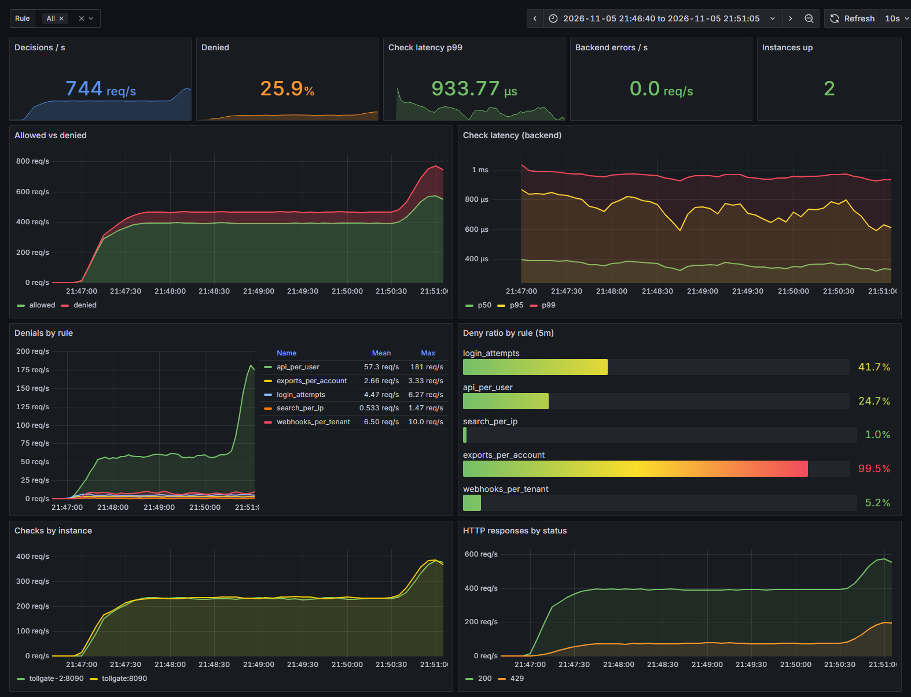
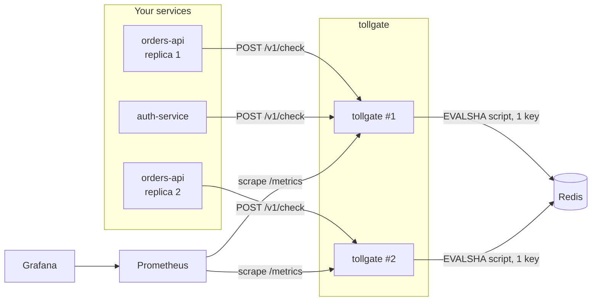
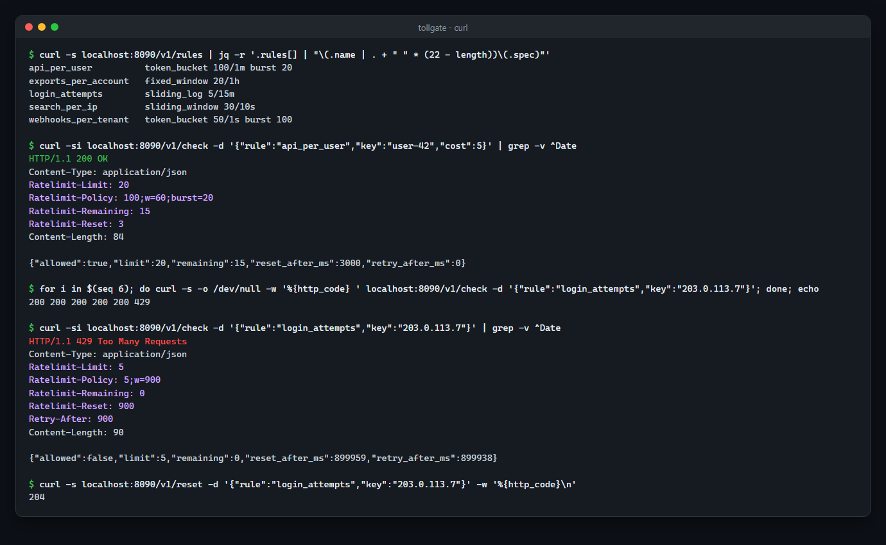
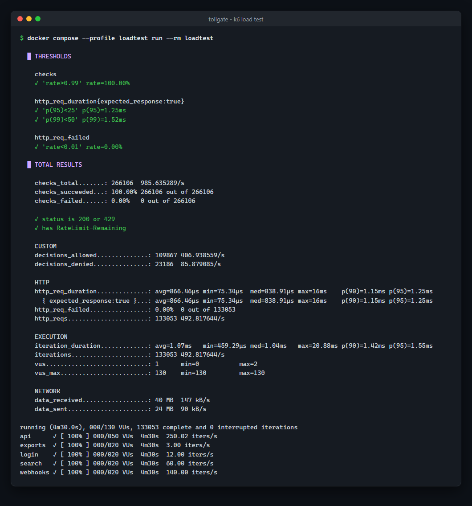

# tollgate

[](https://github.com/berkheev/tollgate/actions/workflows/ci.yml)
[](https://pkg.go.dev/github.com/berkheev/tollgate/client)
[](https://goreportcard.com/report/github.com/berkheev/tollgate)

[](LICENSE)

A standalone rate limiting service. Your applications ask it one question over HTTP — *may this key do this action right now?* — and get an answer that is atomic and consistent across every instance of every app, backed by Redis.



## Why

Rate limiting tends to start as a middleware inside one service, with a counter in local memory. That stops working as soon as the service runs on more than one replica: every replica counts on its own, so the real limit becomes `limit × replicas` and changes every time the autoscaler does something. The next step is usually a Redis `INCR` copied into each codebase, each with its own bugs around expiry, window edges and races between read and write.

tollgate pulls that into one small service:

- limits are declared once, by name, in a YAML file (`login_attempts: sliding_log 5/15m`), instead of being hard-coded in each app;
- every decision is a single Lua script on a single Redis key, so concurrent requests from any number of instances can never over-admit;
- apps get a plain JSON answer plus standard `RateLimit-*` / `Retry-After` headers they can pass straight through to their clients;
- there is one place to watch: Prometheus metrics and a Grafana dashboard for allowed/denied traffic, latency and per-rule denials.

## Features

- **Four algorithms**: token bucket, fixed window, sliding window (weighted counter) and sliding log (exact).
- **Redis backend** with atomic Lua scripts, one key per subject, `EVALSHA` with automatic fallback to `EVAL` on `NOSCRIPT`.
- **In-memory backend** for single-node deployments and tests, sharded to keep lock contention low.
- **Injectable clock**: every algorithm is tested with a fake clock, against both backends.
- **Fail-open or fail-closed** when Redis is unavailable, with readiness that does not take the whole fleet down.
- **HTTP API**: `POST /v1/check`, `POST /v1/reset`, `GET /v1/rules`, `/healthz`, `/readyz`, `/metrics`.
- **Go client** with a `net/http` middleware.
- **Config** from YAML with environment overrides; rules reload on `SIGHUP` without a restart.
- **Operations**: structured JSON logs (`log/slog`), Prometheus metrics, graceful shutdown, distroless image with a built-in health check.
- **Local stack**: Docker Compose with two tollgate replicas, Redis, Prometheus, a provisioned Grafana dashboard and a k6 traffic generator.

## Architecture



tollgate instances are stateless. All limiter state lives in Redis, one key per `(rule, subject)` pair, e.g. `tollgate:api_per_user:tb:user-42`. The algorithm is part of the key, so changing a rule from `fixed_window` to `token_bucket` starts with fresh state instead of failing on a type mismatch.

A check looks like this:

1. The app sends `{"rule": "api_per_user", "key": "user-42", "cost": 1}`.
2. tollgate looks the rule up in the in-memory rule set (swapped atomically on reload).
3. The rule's Lua script runs on Redis with the current time and the rule parameters. It reads the key, decides, writes the new state and sets a TTL, all in one atomic step.
4. tollgate returns the decision as JSON plus `RateLimit-*` headers: `200` when allowed, `429` when denied.

The code is split the same way:

```
cmd/tollgate          entry point: config, wiring, graceful shutdown, SIGHUP reload
internal/ratelimit    rules, algorithms, memory and Redis backends, Lua scripts
internal/server       HTTP handlers, metrics, middleware
internal/config       YAML + env loading and validation
internal/clock        real and fake clocks
client                Go client and net/http middleware
deploy                Prometheus and Grafana provisioning
loadtest              k6 traffic generator
```

## Algorithms

| Algorithm | State per key | Precision | Bursts | Good for |
|---|---|---|---|---|
| `token_bucket` | 2 numbers | exact | controlled by `burst` | APIs, per-user quotas, webhooks |
| `fixed_window` | 2 numbers | exact per window | up to 2× at window edges | coarse quotas (per hour/day), billing-like counts |
| `sliding_window` | 3 numbers | approximate | smoothed | high-volume per-IP limits |
| `sliding_log` | 1 entry per unit | exact | none | low limits where exactness matters: logins, OTP, password resets |

**Token bucket.** A bucket holds up to `burst` tokens (defaults to `limit`) and refills continuously at `limit / window`. Each request takes `cost` tokens. Stored as the token count and the time it was last updated; refill is computed lazily on the next request, so idle keys cost nothing. `token_bucket 100/min burst 20` means a sustained 100 requests per minute, with at most 20 back to back. This is the best default for API traffic: it allows natural short bursts but enforces the long-term rate.

**Fixed window.** Counts units in calendar-aligned windows (`[12:00, 12:01)`, `[12:01, 12:02)`, …). Cheapest and easiest to explain to users ("20 exports per hour"), but a client can spend its full quota at the end of one window and again at the start of the next — up to 2× the limit in a short span.

**Sliding window.** Keeps the counts of the current and the previous fixed window and weights the previous one by how much of it still overlaps the rolling window:

```
estimate = previous × (window − elapsed) / window + current
```

This removes the edge burst of fixed windows at the cost of being an approximation (it assumes requests in the previous window were evenly spread). Memory stays constant regardless of the limit. All the math is scaled by the window length so it stays in integers, both in Go and in Lua.

**Sliding log.** Stores one timestamp per consumed unit in a sorted set and drops entries older than the window. It is exact and gives a precise `retry_after` (the moment the oldest relevant entry falls out), but memory grows with the limit, so tollgate caps it at 10 000 per window. Use it where being exact matters more than memory: `login_attempts: sliding_log 5/15m`.

**Retry and reset times.** Every decision returns `remaining`, `reset_after_ms` (time until the full quota is available again) and, when denied, `retry_after_ms` (the earliest moment the same request would pass). They are computed by the algorithm itself, not guessed: for the token bucket it is the time needed to refill the missing tokens, for the sliding window it solves the weighted formula for the moment the estimate drops low enough.

## Quick start

Requirements: Docker with Compose.

```sh
git clone https://github.com/berkheev/tollgate.git
cd tollgate
docker compose up -d --build
```

This starts two tollgate replicas, Redis, Prometheus and Grafana:

| Service | URL |
|---|---|
| tollgate | http://localhost:8090 |
| Grafana (dashboard, anonymous read access) | http://localhost:3000 |
| Prometheus | http://localhost:9090 |

Generate realistic traffic and watch the dashboard fill up:

```sh
docker compose --profile loadtest run --rm loadtest
```

The load test mixes five kinds of callers against both replicas: a skewed population of API users where a few heavy hitters get throttled, search traffic per IP, a credential-stuffing bot hammering `login_attempts`, report exports with variable cost, and bursty webhook fan-out per tenant. `DURATION=10m` makes the steady phase longer.

Ports can be changed with `TOLLGATE_PORT`, `GRAFANA_PORT` and `PROMETHEUS_PORT`.

## API

All request and response bodies are JSON. Unknown fields are rejected so typos (`"cots": 3`) fail loudly instead of silently using the default.

### `POST /v1/check`

Consumes `cost` units (default `1`) of `rule` for `key`.

```sh
curl -si -X POST localhost:8090/v1/check \
  -d '{"rule":"api_per_user","key":"user-42","cost":5}'
```

```http
HTTP/1.1 200 OK
Content-Type: application/json
Ratelimit-Limit: 20
Ratelimit-Policy: 100;w=60;burst=20
Ratelimit-Remaining: 15
Ratelimit-Reset: 3

{"allowed":true,"limit":20,"remaining":15,"reset_after_ms":3000,"retry_after_ms":0}
```

When the limit is exceeded the status is `429` and `Retry-After` is set:

```http
HTTP/1.1 429 Too Many Requests
Ratelimit-Limit: 5
Ratelimit-Policy: 5;w=900
Ratelimit-Remaining: 0
Ratelimit-Reset: 900
Retry-After: 900

{"allowed":false,"limit":5,"remaining":0,"reset_after_ms":899995,"retry_after_ms":899976}
```

| Field | Meaning |
|---|---|
| `allowed` | whether the request may proceed |
| `limit` | the most units a single key can have available (`burst` for token buckets) |
| `remaining` | units left right now |
| `reset_after_ms` | time until the full quota is back |
| `retry_after_ms` | when denied: time until this same request would be allowed |
| `degraded` | present and `true` when Redis was unreachable and the answer comes from the failure mode |

Errors: `400` for malformed requests, `404` for unknown rules, `413` for oversized bodies, `422` when `cost` is below 1 or above the rule's capacity (such a request could never pass).

### `POST /v1/reset`

Clears the state for one key, e.g. after a successful login or when support unlocks an account.

```sh
curl -s -X POST localhost:8090/v1/reset -d '{"rule":"login_attempts","key":"203.0.113.7"}' -w '%{http_code}\n'
# 204
```

### `GET /v1/rules`

```sh
curl -s localhost:8090/v1/rules
```

```json
{"rules":[{"name":"api_per_user","algorithm":"token_bucket","limit":100,"window":"1m","window_ms":60000,"burst":20,"capacity":20,"spec":"token_bucket 100/1m burst 20"}, ...]}
```

### Operational endpoints

| Endpoint | Purpose |
|---|---|
| `GET /healthz` | liveness: the process is up |
| `GET /readyz` | readiness: pings Redis. In fail-open mode a Redis outage reports `200 {"status":"degraded"}`; in fail-closed mode it reports `503` |
| `GET /metrics` | Prometheus metrics |



## Configuration

tollgate reads a YAML file (path from `-config` or `TOLLGATE_CONFIG`; the Docker image uses `/etc/tollgate/tollgate.yaml`). Environment variables override the file.

```yaml
listen: ":8090"
backend: redis            # redis | memory
failure_mode: open        # open | closed
backend_timeout: 100ms    # per Redis call
shutdown_timeout: 15s

redis:
  url: redis://localhost:6379/0
  key_prefix: tollgate
  pool_size: 0            # 0 = go-redis default (10 per CPU)

log:
  level: info             # debug | info | warn | error
  format: json            # json | text

rules:
  api_per_user: token_bucket 100/min burst 20
  login_attempts: sliding_log 5/15m
  search_per_ip: sliding_window 30/10s
  exports_per_account:     # long form, same thing
    algorithm: fixed_window
    limit: 20
    window: 1h
```

A rule is `<algorithm> <limit>/<window> [burst <n>]`. Windows accept `s`, `sec`, `m`, `min`, `h`, `hour`, `d`, `day`, a number with one of those (`15m`, `1d`) or any Go duration (`1h30m`, `500ms`). `burst` only applies to `token_bucket`. Invalid rules are reported with their line number and tollgate refuses to start.

| Variable | Default |
|---|---|
| `TOLLGATE_CONFIG` | — |
| `TOLLGATE_LISTEN` | `:8090` |
| `TOLLGATE_BACKEND` | `redis` |
| `TOLLGATE_FAILURE_MODE` | `open` |
| `TOLLGATE_BACKEND_TIMEOUT` | `100ms` |
| `TOLLGATE_SHUTDOWN_TIMEOUT` | `15s` |
| `TOLLGATE_REDIS_URL` | `redis://localhost:6379/0` |
| `TOLLGATE_KEY_PREFIX` | `tollgate` |
| `TOLLGATE_LOG_LEVEL` | `info` |
| `TOLLGATE_LOG_FORMAT` | `json` |

**Reloading rules.** Send `SIGHUP` (`docker compose kill -s HUP tollgate`) to re-read the file. The new rule set is validated first and swapped atomically; if it is invalid the old rules stay in place and the error is logged.

**Failure mode.** When Redis cannot be reached within `backend_timeout`:

- `open` (default): requests are allowed, responses carry `"degraded": true` and a `Tollgate-Degraded: true` header, and `tollgate_backend_errors_total` goes up. A limiter outage should not become an outage of everything behind it.
- `closed`: requests are denied with `429` and `Retry-After: 1`. Use it when the limit protects something that must not be overrun, like an SMS provider bill.

## Client

```sh
go get github.com/berkheev/tollgate/client
```

```go
tg := client.New("http://tollgate:8090", client.WithTimeout(50*time.Millisecond))

d, err := tg.Check(ctx, "login_attempts", clientIP)
if err != nil {
    // tollgate itself is unreachable: decide locally
}
if !d.Allowed {
    return fmt.Errorf("too many attempts, retry in %s", d.RetryAfter)
}
```

The middleware rate limits incoming HTTP requests and forwards the `RateLimit-*` / `Retry-After` headers to your callers:

```go
limit := client.Middleware(tg, "api_per_user", client.ByHeader("X-User-ID"),
    client.OnError(func(r *http.Request, err error) {
        slog.Warn("rate limiter unavailable", "err", err)
    }),
)

mux.Handle("GET /orders", limit(ordersHandler))
```

Options: `WithCost` (e.g. charge by batch size), `FailClosed` (return `503` when tollgate is unreachable instead of letting requests through), `OnDenied` (custom `429` response). Requests for which the key function returns an empty string bypass the limiter. `ByRemoteIP` uses the connection address; behind a proxy, write a key function for the header your proxy sets.

## Development

Everything runs in Docker; no local Go toolchain is needed.

```sh
# unit tests + race detector
docker run --rm -v "$PWD":/src -w /src golang:1.26 go test -race ./...

# lint
docker run --rm -v "$PWD":/src -w /src golangci/golangci-lint:v2.15.0 golangci-lint run ./...
```

With a local Go toolchain there are `make` targets: `make test`, `make test-integration` (needs Redis, `REDIS_URL=redis://localhost:6379/15` by default), `make bench`, `make lint`, `make run` (memory backend).

**Tests.** The algorithm tests are table-driven step sequences — advance the fake clock, spend some cost, assert `allowed`, `remaining`, `reset_after` and `retry_after` exactly. The same suite runs against the memory backend and, when `TOLLGATE_TEST_REDIS_URL` is set, against a real Redis through the Lua scripts, which keeps the two implementations from drifting apart. It also covers key isolation, resets, invalid costs and 25 goroutines racing for the same key (exactly `limit` requests must pass). CI runs everything with `-race` against a Redis service container.

**Benchmarks.** `go test -bench . -benchmem ./internal/ratelimit/`, 16 parallel goroutines spread over 1024 keys, measured on an Intel i7-12650H; Redis 7 running in a container on the same machine:

| Algorithm | Memory | Redis |
|---|---|---|
| `token_bucket` | 72 ns/op, 1 alloc | 22.7 µs/op |
| `fixed_window` | 73 ns/op, 1 alloc | 20.8 µs/op |
| `sliding_window` | 70 ns/op, 1 alloc | 20.8 µs/op |
| `sliding_log` | 65 ns/op, 1 alloc | 24.7 µs/op |

The Redis numbers are dominated by the network round trip (about 45k checks/s from one process with the default pool); the script work itself is a handful of hash or sorted-set operations on one key.

**Load test.** The compose `loadtest` service (k6) drives both replicas for 4.5 minutes, including a spike to roughly 750 checks/s. On the same laptop, with everything in Docker Desktop: about 493 requests/s on average, p95 1.25 ms and p99 1.52 ms end to end (k6 → tollgate → Redis), no failed requests, and 17% of decisions denied — which is the point of the exercise.



## Design notes and trade-offs

- **Time comes from tollgate, not from Redis.** The scripts get `now` as an argument instead of calling Redis `TIME`. That is what makes the Lua scripts testable with a fake clock, and it keeps scripts deterministic. The price is that instances need reasonably synced clocks (NTP); a skew of a few milliseconds only shifts window edges by that much. A clock that jumps backwards never refills a token bucket or rewinds a window.
- **One key per subject.** Each script touches exactly one key, so it works unchanged on Redis Cluster and every key carries its own TTL — the time until it would be back to its empty state anyway. Expiring a key is therefore indistinguishable from keeping it, and Redis runs with `volatile-ttl` eviction: under memory pressure the keys closest to expiry go first.
- **Denied requests don't consume quota.** A client that keeps retrying while limited is not punished further. Scripts only write when a request is allowed, so denials are also cheaper.
- **Fail-open by default, and readiness follows the failure mode.** If readiness failed whenever Redis did, a Redis blip would pull every tollgate replica out of the load balancer at once — turning "limits are not enforced" into "every request fails". In fail-open mode `/readyz` stays green and reports `degraded`.
- **Errors are sampled.** When Redis is down every check fails; logging each one would flood the logs exactly when they are needed most. tollgate logs at most one backend error per second and counts all of them in metrics.
- **HTTP/JSON instead of gRPC.** Any language can call it with the HTTP client it already has. A check costs one small request; with keep-alive and a client in the same network, latency is dominated by the Redis round trip.
- **Bounded cardinality.** Metrics are labelled by rule (from config), never by key, and unknown routes share one `unmatched` label.

Not done (yet): per-key overrides (e.g. a higher limit for premium tenants), a local cache that answers obviously denied keys without a Redis round trip, and a gRPC API.

## License

[MIT](LICENSE)
